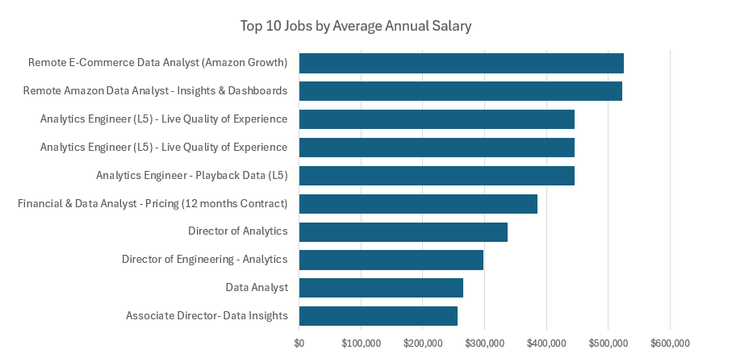
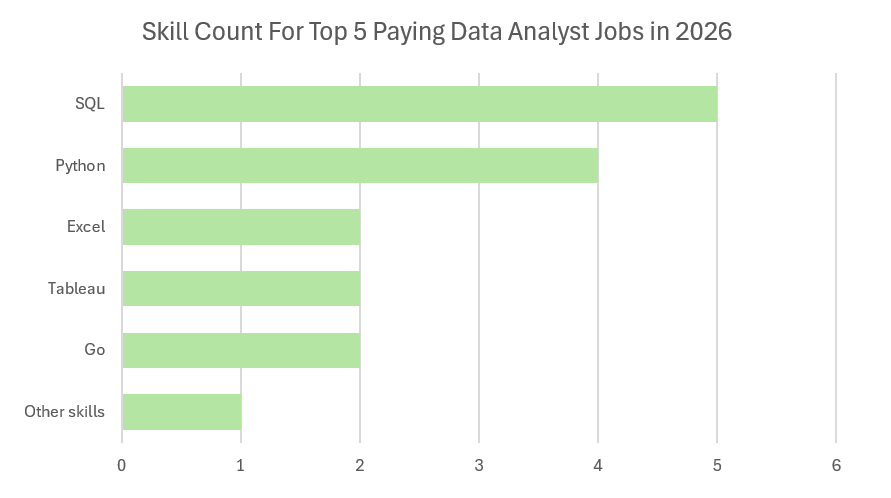
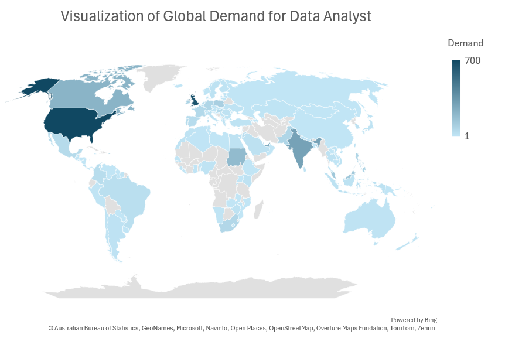

# Introduction
This project aims to provide 📊 insights on the data job market. Particularly the 💰 top-paying jobs, 🔥 in-demand skills, 📈 where high demand meets salary, and top job and skill demand by 🌍 country in data analytics.

🔎 SQL queries? Check them out here: [project_sql folder](/project_sql/)

# Background

This serves as my first official project in data analytics. The data used are based on Luke Barousse's SQL for Data Analytics course [SQL course](https://lukebarousse.com/sql). I updated the database to reflect the data as of October 2026.


### The questions I wanted to answer through my SQL queries were:

1. What are the top-paying data analyst jobs?
2. What skills are required for these top-paying
jobs?
3. What skills are most in demand for data
analysts?
4. Which skills are associated with higher
salaries?
5. What are the most optimal skills to learn?
6. What are the top 10 countries with the highest demand for data analyst?

# Tools I Used

The following tools were used to perform a deep dive analysis into the data analyst job market:

- **SQL**: The language used to query the database and discover critical insights.
- **PostgreSQL**: The chosen database management
system, ideal for handling the job posting data.
- **Visual Studio Code**: The tool for executing SQL queries.
- **Microsoft Excel**: For visualization
- **Git & GitHub**: Essential for version control and
sharing my SQL scripts and analysis, ensuring
collaboration and project tracking.

# Pre-analysis
As the original database contains job postings with unusually high and low salary, I have determined the top and bottom 1% from the salary column using this SQL query:

### Bottom 1% and Top 1% salary year average for remote data analyst postings
```sql
SELECT Q.salary_quartile, MAX(Q.salary_year_avg) AS quartile_break
FROM
    (SELECT *,
        NTILE(100) OVER (ORDER BY job_postings_fact.salary_year_avg) AS salary_quartile
     FROM job_postings_fact
     WHERE job_postings_fact.salary_year_avg IS NOT NULL AND
           job_postings_fact.job_work_from_home = TRUE AND
           job_postings_fact.job_title_short = 'Data Analyst') AS Q
WHERE Q.salary_quartile IN (1,99)
GROUP BY Q.salary_quartile;
```

The results:
| salary_ntile % | value |
|:---|---:|
| 1 | 31,500 |
| 99 | 524,000 |


### Bottom 1% and Top 1% of the salary_year_avg column from data analyst postings (remote/non-remote)
```sql
SELECT Q.salary_quartile, MAX(Q.salary_year_avg) AS quartile_break
FROM
    (SELECT *,
        NTILE(100) OVER (ORDER BY job_postings_fact.salary_year_avg) AS salary_quartile
     FROM job_postings_fact
     WHERE job_postings_fact.salary_year_avg IS NOT NULL AND
           job_postings_fact.job_title_short = 'Data Analyst') AS Q
WHERE Q.salary_quartile IN (1,99)
GROUP BY Q.salary_quartile;
```

The results:
| salary_ntile % | value |
|:---|---:|
| 1 | 30,000 |
| 99 | 336,500 |

I have used the results to filter out salary data that go beyond and under the top 1% and bottom 1% respectively. In this manner, the insights are not based on skewed data.

**Query reference**:
 [Detecting Outliers: Inter-Quartile Range Approach](https://medium.com/@kunalkishor.k/detecting-outliers-using-interquartile-range-with-sql-syntaxe-c9707f453acf) by *Kunal Kishore*

# The Analysis
Each query for this project aimed at investigating specific aspects of the data analyst job market. 


Here's how I approached each question:

### 1. Top Paying Data Analyst Jobs
To identify the highest-paying roles, I filtered
data analyst positions by average yearly salary
and location, focusing on remote jobs. This query highlights the high paying opportunities in the field.

```sql
SELECT
    job_id, 
    job_title,
    job_location,
    job_schedule_type,
    salary_year_avg,
    job_posted_date,
    name AS company_name
FROM
    job_postings_fact
LEFT JOIN company_dim ON job_postings_fact.company_id = company_dim.company_id
WHERE
    job_title_short = 'Data Analyst' AND
    job_work_from_home = TRUE AND
    salary_year_avg BETWEEN 31500 AND 524000
ORDER BY salary_year_avg DESC
LIMIT 10
```
Here's the breakdown of the top data analyst jobs in 2026:
- **Wide Salary Range:** Top 10 paying data
analyst roles span from $255,829.50 to $524,000.00,
indicating significant salary potential in the
field.
- **Diverse Employers:** Companies like
RocketAMS, Netflix, and Siemens are among those
offering high salaries, showing a broad interest
across different industries.
- **Job Title Variety:** There's a high diversity in job titles, from *Data Analyst* to *Director of Analytics*, reflecting varied roles and specializations within data analytics.



*Bar graph visualizing the salary for the top 10
salaries for data analysts; Chart was generated using Microsoft Excel.*

### 2. Skills for Top Paying Jobs
To understand what skills are required for the top-paying jobs, I joined the job postings with the skills data, providing insights into what employers value for high-compensation roles.

```sql
WITH top_paying_jobs AS (
    SELECT
        job_id, 
        job_title,
        salary_year_avg,
        name AS company_name
    FROM
        job_postings_fact
    LEFT JOIN company_dim ON job_postings_fact.company_id = company_dim.company_id
    WHERE
        job_title_short = 'Data Analyst' AND
        job_work_from_home = TRUE AND
        salary_year_avg BETWEEN 31500 AND 524000
    ORDER BY salary_year_avg DESC
    LIMIT 10
)

SELECT 
    top_paying_jobs.*,
    skills_dim.skills
FROM top_paying_jobs
INNER JOIN skills_job_dim ON top_paying_jobs.job_id = skills_job_dim.job_id
INNER JOIN skills_dim ON skills_job_dim.skill_id = skills_dim.skill_id
ORDER BY
    salary_year_avg DESC
```

Here's the breakdown of the most demanded skills for the top 5 highest paying data analyst jobs in 2026:

- **SQL** is leading with a bold count of 5.
- **Python** follows with a bold count of 4.
- **Excel, Tableau and Go** is also sought after, with a bold count of 2.
- **Other skills**: R, Git, Scala, AWS, Powerpoint, Power BI, Graphql, Databricks, Pyspark, Jupyter, Sap, Kubernetes, Azure, Spreadsheet, Looker, Typescript, Node,  and Pandas




*Bar graph visualizing the count of skills for the top 5 paying jobs for data analysts; Chart was generated from Microsoft Excel.

### 3. In-Demand Skills for Data Analysts

This query helped identify the skills most frequently requested in job postings, directing focus to areas with high demand.

```sql
SELECT 
    skills,
    COUNT(skills_job_dim.job_id) AS demand_count
FROM job_postings_fact
INNER JOIN skills_job_dim ON job_postings_fact.job_id = skills_job_dim.job_id
INNER JOIN skills_dim ON skills_job_dim.skill_id = skills_dim.skill_id
WHERE job_title_short = 'Data Analyst' AND
      job_work_from_home = TRUE
GROUP BY skills
ORDER BY demand_count DESC
LIMIT 5
```
Here's the breakdown of the most demanded skills for data analysts in 2023

- SQL remains fundamental, emphasizing the need for strong foundational skills in data processing and spreadsheet
manipulation.
- Programming and Visualization Tools like Python, Tableau, and Power BI are essential, pointing towards the increasing
importance of technical skills in data storytelling and decision support.

### Top 5 Most Demanded Skills for Data Analysts

| Skill | Demand Count |
|:---|---:|
| SQL | 18,264 |
| Python | 11,907 |
| Excel | 10,986 |
| Tableau | 9,898 |
| Power BI | 7,401 |

*Table of the demand for the top 5 skills in data analyst job postings*

### 4. Skills Based on Salary

Exploring the average salaries associated with different skills revealed which skills are the highest paying.

```sql
SELECT 
    skills,
    ROUND(AVG(salary_year_avg), 0) AS average_salary
FROM job_postings_fact
INNER JOIN skills_job_dim ON job_postings_fact.job_id = skills_job_dim.job_id
INNER JOIN skills_dim ON skills_job_dim.skill_id = skills_dim.skill_id
WHERE job_title_short = 'Data Analyst' AND
      job_work_from_home = TRUE AND
      salary_year_avg BETWEEN 31500 AND 524000
GROUP BY skills
ORDER BY average_salary DESC
LIMIT 25
```

Here's a breakdown of the results for top paying skills for Data Analysts:

- **TypeScript leads by a significant margin**, with an average salary of $445,000, considerably higher than GraphQL at $264,000. This suggests strong earning potential for specialized programming skills, although the figures should be validated against the dataset.
- **The top 10 skills span several technical areas**, including development (TypeScript, Node, Swift), data infrastructure (Couchbase), and API technologies (GraphQL). This highlights the potential value of combining programming expertise with specialized technical knowledge.
- **Collaboration and productivity tools also appear**, with Trello, Bitbucket, and Atlassian ranking among the top 10. Their presence may reflect higher-paying roles in software development teams, rather than these tools directly commanding higher salaries.


| Skill | Average Salary ($) |
|---|---:|
| TypeScript | 445,000 |
| GraphQL | 264,000 |
| Node | 174,406 |
| Trello | 171,396 |
| Perl | 168,000 |
| Bitbucket | 166,103 |
| Couchbase | 160,515 |
| DataRobot | 155,486 |
| Swift | 153,750 |
| Atlassian | 152,145 |

*Table of the average salary for the top 10 paying skills for data analysts*

### 5. Most Optimal Skills to Learn

Combining insights from demand and salary data, this query aimed to pinpoint skills that are both in high demand and have high salaries,
offering a strategic focus for skill development.

```sql
SELECT 
    skills_dim.skill_id,
    skills_dim.skills,
    COUNT(skills_job_dim.job_id) AS demand_count,
    ROUND(AVG(job_postings_fact.salary_year_avg), 0) AS avg_salary
FROM job_postings_fact
INNER JOIN skills_job_dim ON job_postings_fact.job_id = skills_job_dim.job_id
INNER JOIN skills_dim ON skills_job_dim.skill_id = skills_dim.skill_id
WHERE
    job_title_short = 'Data Analyst'
    AND salary_year_avg BETWEEN 31500 AND 524000
    AND job_work_from_home = True 
GROUP BY
    skills_dim.skill_id
HAVING
    COUNT(skills_job_dim.job_id) > 10
ORDER BY
    demand_count DESC,  -- move demand_count to be first in the ORDER BY
    avg_salary DESC 
LIMIT 25; 
```


| Skill ID | Skill | Demand Count | Average Salary ($) |
|---:|---|---:|---:|
| 0 | SQL | 954 | 98,751 |
| 1 | Python | 601 | 99,156 |
| 183 | Tableau | 577 | 99,336 |
| 184 | Excel | 557 | 87,314 |
| 186 | Power BI | 355 | 89,873 |
| 2 | R | 340 | 97,912 |
| 185 | Looker | 148 | 97,577 |
| 8 | SAS | 120 | 94,487 |
| 194 | SAS | 120 | 94,487 |
| 73 | Snowflake | 113 | 107,994 |

*Table of the most optimal skills for data analyst sorted by salary*

Here's a breakdown of the most optimal skills for Data Analysts in 2026:

- **SQL** is the most demanded skill, appearing in 954 job postings, followed by **Python** (601) and **Tableau** (577). This highlights the importance of SQL and Python, alongside data visualization tools, for data analyst roles.

- **Snowflake** offers the highest average salary at $107,994, despite appearing in only 113 job postings. **Python** ($99,156), **Tableau** ($99,336), and **SQL** ($98,751) also combine strong demand with competitive salaries.

- **Excel** remains highly sought after despite a lower average salary of $87,314, while **Power BI** ($89,873) also shows solid demand. This suggests that combining foundational tools like Excel with SQL, Python, and specialized platforms such as Snowflake could help analysts strengthen their career prospects.

### 6. Countries with high Data Analyst demand

This query aims to identify the countries where Data Analysts are sought after. I have used both SQL and Excel to generate the report and visualize it.

```sql
SELECT
    job_postings_fact.job_country,
    COUNT(job_postings_fact.job_id) AS demand_count
FROM
    job_postings_fact
WHERE
    job_postings_fact.job_country IS NOT NULL
    AND job_postings_fact.job_title_short = 'Data Analyst'
    AND salary_year_avg BETWEEN 30000 AND 336500
GROUP BY
    job_postings_fact.job_country
ORDER BY
    demand_count DESC;
```



*The count has been capped at 700. **The United States currently has a demand for 24,283** data analyst. This chart was generated using Microsoft Excel*


| Country | Demand Count |
|---|---:|
| United States | 24,283 |
| United Kingdom | 647 |
| India | 297 |
| United Arab Emirates | 254 |
| Canada | 219 |
| Sudan | 187 |
| Malaysia | 130 |
| Puerto Rico | 100 |
| Poland | 97 |
| Ireland | 82 |


Below are some insights from this data:
- **The United States dominates job demand**, with 24,283 postings, far exceeding the United Kingdom (647) and all other countries in the table.

- **The UK, India, and the UAE follow**, but their job posting counts are significantly lower, suggesting that the US is the largest market represented in this dataset.

- **Demand is geographically diverse**, with opportunities across North America, Europe, Asia, and the Middle East. However, the results reflect the dataset's job postings rather than the entire global job market.

# What I Learned

Throughout this adventure, I've turbocharged my
SQL toolkit with some serious firepower:

- **🧩 Complex Query Crafting:** Mastered the art of advanced SQL, merging tables like a pro and
wielding WITH clauses for ninja-level temp table
maneuvers.
- **📊 Data Aggregation:** Got cozy with GROUP BY
and turned aggregate functions like COUNT() and AVG() into my data-summarizing sidekicks. ₹
- **💡 Analytical Wizardry:** Leveled up my
real-world puzzle-solving skills, turning
questions into actionable, insightful SQL queries.
- **❌ Removed Outlier:** Discovered the application of Inter-Quartile Range (IQR) in order to avoid skewed data.

# Conclusions

### Insights

From the analysis, several general insights
emerged:

1. **Top-Paying Data Analyst Jobs**: The
highest-paying jobs for data analysts that allow
remote work offer a wide range of salaries, the
highest at $524,000!
2. **Skills for Top-Paying Jobs**: High-paying
data analyst jobs require advanced proficiency in
SQL, suggesting it's a critical skill for earning
a top salary.
3. **Most In-Demand Skills**: SQL is also the most
demanded skill in the data analyst job market,
thus making it essential for job seekers.
4. **Skills with Higher Salaries**: Specialized
skills, such as TypeScript and GraphQL, are associated
with the highest average salaries, indicating a
premium on niche expertise.
5. **Optimal Skills for Job Market Value**: SQL
leads in demand and offers for a high average
salary, positioning it as one of the most optimal
skills for data analysts to learn to maximize
their market value.

### Closing Thoughts

This project enhanced my SQL skills and provided
valuable insights into the data analyst job
market. The findings from the analysis serve as a guide to prioritizing skill development and job search efforts. Aspiring data analysts can better position themselves in a competitive job market by focusing on high-demand, high-salary skills.This exploration highlights the importance of continuous learning and adaptation to emerging trends in the field of data analytics. 